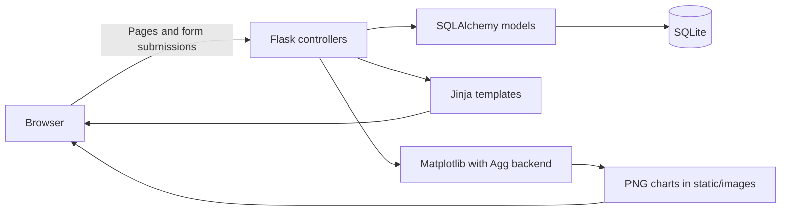
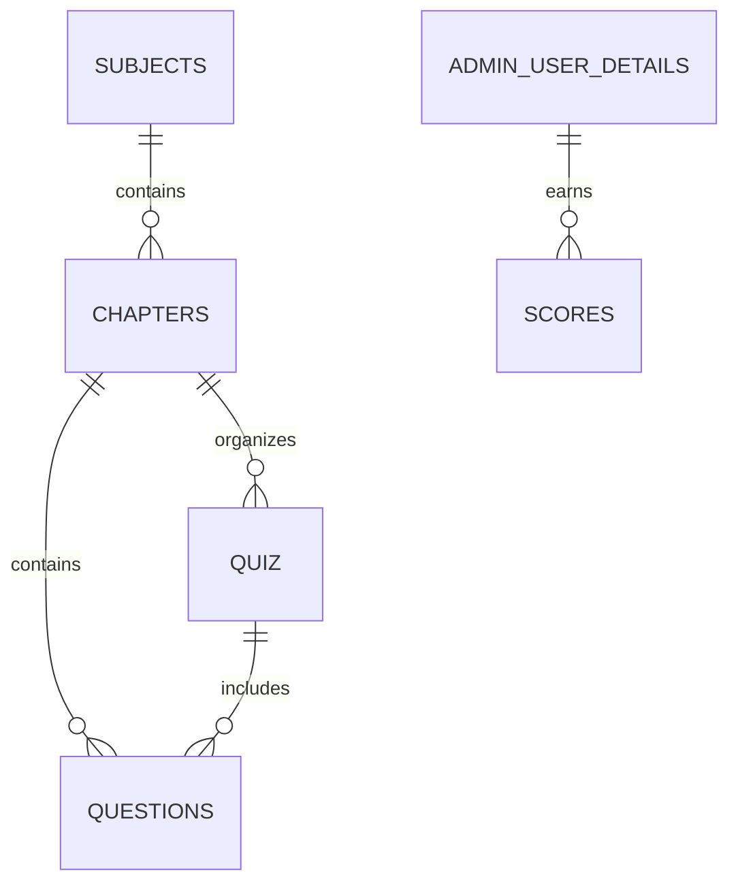

# Quiz Master

A Flask-based quiz management application with separate administrator and learner workflows. Administrators organize subjects and chapters, create quizzes, and maintain multiple-choice questions. Learners browse quizzes, submit answers, and review their scores and performance charts.

This Modern Application Development project uses server-rendered Jinja templates, SQLAlchemy models, a local SQLite database, and Matplotlib-generated chart images.

## Contents

- [Features](#features)
- [Architecture and technology](#architecture-and-technology)
- [Repository structure](#repository-structure)
- [Local setup](#local-setup)
- [Accounts and walkthrough](#accounts-and-walkthrough)
- [Quiz and scoring behavior](#quiz-and-scoring-behavior)
- [Data model](#data-model)
- [Application routes](#application-routes)
- [Verification and troubleshooting](#verification-and-troubleshooting)
- [Current limitations](#current-limitations)

## Features

| Role | Functionality |
| --- | --- |
| Administrator | Create, edit, and delete subjects and chapters; create quizzes with date/duration fields; add and delete questions; access a question-edit form; search subjects, chapters, and quizzes; view attempts and average-score charts. |
| Learner | Register, log in, browse and search quizzes, view quiz details, submit multiple-choice answers, inspect score history, and view personal performance charts. |

The hierarchy is **Subject → Chapter → Quiz → Questions**, with score records associated with a learner and a quiz attempt. Question-edit persistence has a known field-name mismatch described under [Current limitations](#current-limitations).

## Architecture and technology



| Layer | Technology |
| --- | --- |
| Application | Python, Flask |
| Database | SQLite, Flask-SQLAlchemy |
| Interface | Jinja2, HTML, CSS |
| Reporting | Matplotlib, using the non-interactive `Agg` backend |

The application does not require Node.js, Redis, a JavaScript build step, or a separate API server.

## Repository structure

```text
quiz_master_23f3002149/
|-- app.py                          # Application setup and database configuration
|-- backend/
|   |-- models.py                   # Users, subjects, chapters, quizzes, questions, scores
|   `-- controllers.py              # Routes, form processing, scoring, chart generation
|-- instance/quiz_master.sqlite3     # Tracked SQLite database
|-- templates/                      # Login, registration, administrator and learner pages
|-- static/
|   |-- css/                        # Styles for individual screens
|   `-- images/                     # Generated administrator and user chart PNGs
|-- Project Report_ Quiz_Master_Application.pdf
`-- README.md
```

The [project report](Project%20Report_%20Quiz_Master_Application.pdf) is included as a PDF. The README describes the current source behavior, including implementation gaps that may differ from intended project features.

## Local setup

### 1. Clone and create a Python environment

Python 3.11 or newer is a recommended starting point. The repository does not currently contain a requirements file or dependency lock.

```bash
git clone https://github.com/23f3002149/quiz_master_23f3002149.git
cd quiz_master_23f3002149
python -m venv .venv
```

Activate it in PowerShell:

```powershell
.\.venv\Scripts\Activate.ps1
```

Or on macOS/Linux:

```bash
source .venv/bin/activate
```

### 2. Install dependencies

```bash
python -m pip install Flask Flask-SQLAlchemy matplotlib
```

Jinja2 and SQLAlchemy are installed as dependencies. Python includes the SQLite driver.

### 3. Start the application

Run from the repository root so relative paths for chart images resolve correctly:

```bash
python app.py
```

Open `http://127.0.0.1:5000/`.

The setup creates missing tables in `instance/quiz_master.sqlite3`. A database snapshot is already included, so a clone may contain existing subjects, accounts, and scores. Back it up before experimenting with existing records.

The startup structure has an unusual detail: `backend/controllers.py` contains an unconditional `app.run(debug=True)`. Importing the controller or the root application can start the development server. Use the documented script entry point; conventional Flask CLI commands, test imports, and WSGI deployment need a startup refactor first.

No `.env` file is read. The database URI and cookie configuration live in [app.py](app.py).

## Accounts and walkthrough

Regular registration at `/new_registration` creates `role = 1` users. Administrators have `role = 0` and are not automatically seeded on a new empty database.

To create your own local administrator:

1. Register an account using details you control.
2. Stop the server.
3. Open `instance/quiz_master.sqlite3` in a SQLite editor and run this statement after replacing the email:

```sql
UPDATE admin_user_details
SET role = 0
WHERE email_username = 'your-registered-email@example.com';
```

4. Save the database, restart the application, and log in using that account.

The current application stores passwords directly. Use a disposable local-demo password; password hashing is a follow-up requirement.

For a complete walkthrough:

1. As administrator, create a subject and a chapter under it.
2. Create a quiz for that chapter. The create route allows only one quiz per chapter.
3. Add multiple-choice questions, supplying four options and the correct answer.
4. Register a separate learner and open the learner dashboard.
5. View the quiz details, start the quiz, select answers, and submit.
6. Review the new attempt in score history and the personal summary.
7. Open the administrator summary to inspect attempt counts and average scores.

## Quiz and scoring behavior

- Each question has four text options and one stored correct-option value.
- On submission, the controller compares the posted answer with the stored `correct_option` value.
- Each correct answer adds **one point**. Incorrect or unanswered questions add zero; negative marking is not implemented.
- Each submission creates a new score record with the question count, chapter name, learner ID, quiz ID, and submission date. Repeat attempts are stored separately.
- Date and duration fields exist on a quiz, but there is no countdown, automatic submission, or server-enforced time/date window in the current attempt flow.
- The quiz form displays all questions together.
- Learner summaries show the number of attempts, average raw score, performance over time, and correct-versus-incorrect answers.
- Administrator summaries show attempts and average raw scores by quiz.

Chart files are generated under `static/images/`. Learner chart filenames include the user ID; administrator charts use shared filenames.

## Data model

| Model / table | Purpose |
| --- | --- |
| `Admin_User_Details` / `admin_user_details` | Account email/username, password, full name, qualification, date of birth, and role. |
| `Subjects` / `subjects` | Unique subject name and description, with related chapters. |
| `Chapters` / `chapters` | Chapter name, description, and parent subject. |
| `Quiz` / `quiz` | Parent chapter, copied chapter name, quiz date, and duration. |
| `Questions` / `questions` | Chapter and quiz references, title, question text, four options, and correct option. |
| `Scores` / `scores` | A learner's attempt: raw score, question count, date, chapter name, and quiz identifier. |



`Scores.quiz_id` is intentionally stored as an integer without a database foreign key. Scores can therefore outlive a deleted quiz, but some summary code still assumes the corresponding quiz exists.

The source retains field spellings such as `Full_name`, `discription`, `option_a`, and `correct_option`; use these exact names when working directly with the models.

## Application routes

These routes render HTML or handle form submissions.

| Area | Main routes |
| --- | --- |
| Account access | `GET/POST /`, `GET/POST /new_registration`, `GET /logout` |
| Dashboards | `GET /admin_home`, `GET /user_home/<user_id>` |
| Subjects | `GET/POST /new_subject`, `GET /edit_subject/<subject_id>`, `GET/POST /edit_only_subject/<subject_id>`, `GET /delete_subject/<subject_id>` |
| Chapters | `GET/POST /new_chapter/<subject_id>`, `GET/POST /new_chapter_1`, `GET /edit_chapter/<chapter_id>`, `GET/POST /edit_only_chapter/<chapter_id>`, `GET /delete_chapter/<chapter_id>` |
| Quizzes | `GET/POST /admin_quiz`, `GET/POST /add_newquiz`, `GET /delete_quiz/<quiz_id>` |
| Questions | `GET/POST /add_question/<chapter_id>/<quiz_id>`, `GET/POST /edit_question/<question_id>/<chapter_id>/<quiz_id>`, `GET /delete_question/<question_id>` |
| Quiz participation | `GET /view_details/<chapter_id>/<user_id>`, `GET/POST /start_test/<quiz_id>/<user_id>` |
| Scores and reports | `GET /score/<user_id>`, `GET /user_summary/<user_id>`, `GET /admin_summary` |
| Search | `GET/POST /search/<admin>`, `/search_quiz`, `/search_user_home/<user_id>`, `/search_user_score/<user_id>` |

Administrator subject search matches subject or chapter names. Learner quiz and score searches match chapter names or date text. Implementation details are in [backend/controllers.py](backend/controllers.py).

## Verification and troubleshooting

No automated test suite is included. Useful manual checks are:

1. Register and sign in with a learner and an administrator.
2. Create the subject → chapter → quiz → question hierarchy.
3. Submit an attempt with a known number of correct answers and compare the stored score.
4. Submit a second attempt and confirm that it creates a separate score record.
5. Search by chapter name and date, and inspect both summary pages.
6. Check that chart images can be written and loaded.

| Symptom | What to check |
| --- | --- |
| Missing Flask/SQLAlchemy/Matplotlib import | Activate the virtual environment and install all three dependencies. |
| Administrator pages fail on a fresh database | Create and promote a local account before opening administrator pages. |
| Port `5000` is already in use | Stop the other Flask project or existing development process. |
| Chart image cannot be saved | Start from the repository root and make sure `static/images/` is writable. |
| Import unexpectedly starts a server | The controller calls `app.run()` at import time; use `python app.py` for the current version. |
| Editing an answer does not persist | The edit handler writes `option_1`–`option_4` and `correct_answer`, but the model uses `option_a`–`option_d` and `correct_option`. |
| Administrator summary fails after quiz deletion | Historical scores may refer to a quiz that no longer exists; the summary dereferences that quiz. |
| Schema differs after a model edit | `db.create_all()` does not migrate existing tables. |

## Current limitations

- Passwords are stored without hashing, and login redirects do not establish an authenticated session used to authorize subsequent routes. Administrator/user URLs need server-side access checks.
- Deletion is performed through GET routes, and CSRF protection is not implemented.
- The question-edit handler uses fields that do not match mapped model columns, so answer edits may not update stored options or the correct answer.
- Quiz date and duration are metadata only. The duration column is declared as an integer, while the form submits an `HH:MM` time string.
- Quiz submission resolves the user again by full name, which is not unique, instead of consistently using the numeric user ID.
- The attempt submission path assumes the quiz has at least one question; empty or stale quiz records need validation.
- Deleting quizzes leaves score history behind, while administrator summary code assumes those quizzes still exist.
- The session secret changes on each startup, and secure cookies are configured even though the documented development server uses HTTP.
- The import-time server start requires refactoring for conventional testing and production hosting.
- Database snapshots, generated images, and Python bytecode are tracked; dependency versions, database migrations, and automated tests are not supplied.

No license file is currently included in this repository.
